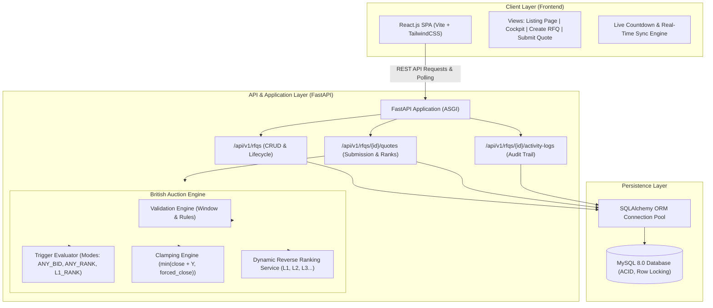
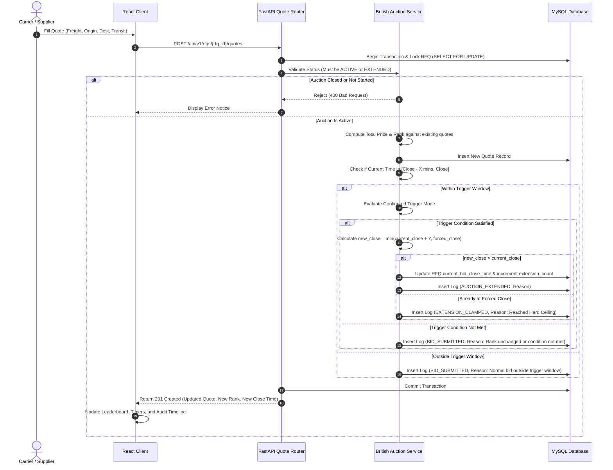

# High-Level Design (HLD)
# British Auction in RFQ System

## 1. System Architecture Diagram

---

## 2. Core Components Description

### 2.1 React Frontend
- **RFQ Listing View**: Displays all active, scheduled, extended, and closed RFQs with live countdowns, current $L_1$ quotes, and quick navigation.
- **RFQ Details / Live Cockpit**: Dual-pane command center showing:
  - Top header with dynamic status badge, close countdown, and British Auction settings ($X$, $Y$, Trigger Mode).
  - Supplier Ranking Board ($L_1, L_2 \dots$) and itemized cost breakdown.
  - Interactive Quote Submission form for testing carrier bidding.
  - Chronological Activity Log showing every bid, extension, and human-readable reason.
- **RFQ Creation Modal**: Form with input validation ensuring `Bid Start < Bid Close < Forced Close`, and $X, Y > 0$.

### 2.2 FastAPI Backend
- **Layered Architecture**: Routers $\rightarrow$ Services $\rightarrow$ Data Models $\rightarrow$ Database.
- **Concurrency & Transaction Safety**: In MySQL, quotes and RFQ close time updates are wrapped in an atomic database transaction. Using `SELECT ... FOR UPDATE` on the RFQ record ensures concurrent bids within the trigger window are serialized and evaluated safely.
- **Clean RESTful Contracts**: Pydantic v2 models validate all inbound payloads and format outgoing responses.

---

## 3. Bid Submission & Extension Sequence Flow

---

## 4. Reverse Ranking & Extension Decision Matrix

| Trigger Mode | Scenario in Last $X$ Minutes | Does Auction Extend? | Extension Reason Logged |
| :--- | :--- | :---: | :--- |
| **`ANY_BID`** | Any carrier submits any valid quote | **YES** (by $+Y$ mins, clamped to forced close) | *"New bid placed by [Carrier] in last X mins"* |
| **`ANY_RANK_CHANGE`** | Supplier B beats Supplier A, shifting ranks $L_2 \leftrightarrow L_3$ | **YES** | *"Supplier ranking changed (Carrier jumped from L3 to L2)"* |
| **`ANY_RANK_CHANGE`** | Supplier submits quote but remains at rank $L_4$ without altering any rank | **NO** | *"Bid submitted without altering supplier rankings"* |
| **`L1_RANK_CHANGE`** | Supplier submits new overall lowest quote ($L_1$) | **YES** | *"New lowest bidder (L1) established by [Carrier]"* |
| **`L1_RANK_CHANGE`** | Supplier improves their own quote from $L_3$ to $L_2$, but $L_1$ stays intact | **NO** | *"Quote improved rank to L2, but L1 remained unchanged"* |
| **ANY MODE** | Calculated `close + Y > forced_close` | **CLAMPED** | *"Extended to hard ceiling: Forced Close Time reached"* |
| **ANY MODE** | `current_close == forced_close` | **NO** | *"Cannot extend: Forced Bid Close Time limit reached"* |
