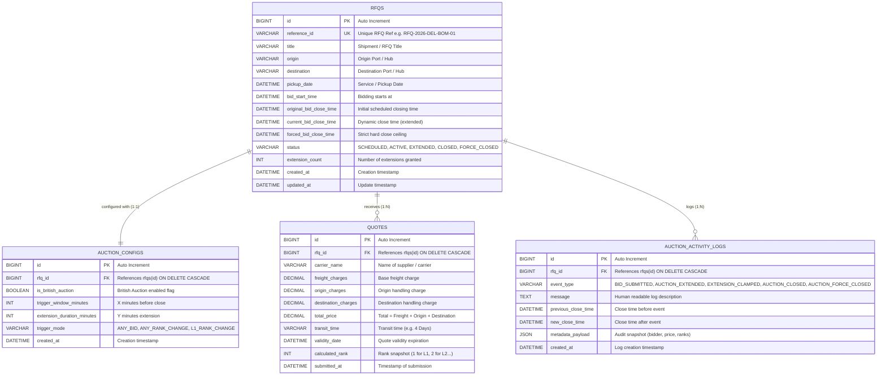

# Database Schema Design
# British Auction in RFQ System

## 1. Entity Relationship (ER) Diagram



---

## 2. MySQL DDL Script

```sql
-- Database creation
CREATE DATABASE IF NOT EXISTS british_auction_rfq CHARACTER SET utf8mb4 COLLATE utf8mb4_unicode_ci;
USE british_auction_rfq;

-- Table 1: rfqs
CREATE TABLE IF NOT EXISTS rfqs (
    id BIGINT AUTO_INCREMENT PRIMARY KEY,
    reference_id VARCHAR(100) NOT NULL UNIQUE,
    title VARCHAR(255) NOT NULL,
    origin VARCHAR(150) NOT NULL,
    destination VARCHAR(150) NOT NULL,
    pickup_date DATETIME NOT NULL,
    bid_start_time DATETIME NOT NULL,
    original_bid_close_time DATETIME NOT NULL,
    current_bid_close_time DATETIME NOT NULL,
    forced_bid_close_time DATETIME NOT NULL,
    status VARCHAR(50) NOT NULL DEFAULT 'ACTIVE',
    extension_count INT NOT NULL DEFAULT 0,
    created_at DATETIME NOT NULL DEFAULT CURRENT_TIMESTAMP,
    updated_at DATETIME NOT NULL DEFAULT CURRENT_TIMESTAMP ON UPDATE CURRENT_TIMESTAMP,
    
    INDEX idx_rfq_status (status),
    INDEX idx_rfq_current_close (current_bid_close_time),
    INDEX idx_rfq_forced_close (forced_bid_close_time)
) ENGINE=InnoDB DEFAULT CHARSET=utf8mb4 COLLATE=utf8mb4_unicode_ci;

-- Table 2: auction_configs
CREATE TABLE IF NOT EXISTS auction_configs (
    id BIGINT AUTO_INCREMENT PRIMARY KEY,
    rfq_id BIGINT NOT NULL UNIQUE,
    is_british_auction BOOLEAN NOT NULL DEFAULT TRUE,
    trigger_window_minutes INT NOT NULL DEFAULT 10,
    extension_duration_minutes INT NOT NULL DEFAULT 5,
    trigger_mode ENUM('ANY_BID', 'ANY_RANK_CHANGE', 'L1_RANK_CHANGE') NOT NULL DEFAULT 'L1_RANK_CHANGE',
    created_at DATETIME NOT NULL DEFAULT CURRENT_TIMESTAMP,
    
    CONSTRAINT fk_auction_configs_rfq
        FOREIGN KEY (rfq_id) REFERENCES rfqs(id) ON DELETE CASCADE
) ENGINE=InnoDB DEFAULT CHARSET=utf8mb4 COLLATE=utf8mb4_unicode_ci;

-- Table 3: quotes
CREATE TABLE IF NOT EXISTS quotes (
    id BIGINT AUTO_INCREMENT PRIMARY KEY,
    rfq_id BIGINT NOT NULL,
    carrier_name VARCHAR(150) NOT NULL,
    freight_charges DECIMAL(12, 2) NOT NULL,
    origin_charges DECIMAL(12, 2) NOT NULL,
    destination_charges DECIMAL(12, 2) NOT NULL,
    total_price DECIMAL(12, 2) NOT NULL,
    transit_time VARCHAR(100) NOT NULL,
    validity_date DATETIME NOT NULL,
    calculated_rank INT NOT NULL DEFAULT 1,
    submitted_at DATETIME NOT NULL DEFAULT CURRENT_TIMESTAMP,
    
    INDEX idx_quotes_rfq (rfq_id),
    INDEX idx_quotes_total_price (total_price ASC),
    INDEX idx_quotes_submitted_at (submitted_at ASC),
    CONSTRAINT fk_quotes_rfq
        FOREIGN KEY (rfq_id) REFERENCES rfqs(id) ON DELETE CASCADE
) ENGINE=InnoDB DEFAULT CHARSET=utf8mb4 COLLATE=utf8mb4_unicode_ci;

-- Table 4: auction_activity_logs
CREATE TABLE IF NOT EXISTS auction_activity_logs (
    id BIGINT AUTO_INCREMENT PRIMARY KEY,
    rfq_id BIGINT NOT NULL,
    event_type VARCHAR(50) NOT NULL,
    message TEXT NOT NULL,
    previous_close_time DATETIME NULL,
    new_close_time DATETIME NULL,
    metadata_payload JSON NULL,
    created_at DATETIME NOT NULL DEFAULT CURRENT_TIMESTAMP,
    
    INDEX idx_activity_logs_rfq (rfq_id),
    INDEX idx_activity_logs_created_at (created_at DESC),
    CONSTRAINT fk_activity_logs_rfq
        FOREIGN KEY (rfq_id) REFERENCES rfqs(id) ON DELETE CASCADE
) ENGINE=InnoDB DEFAULT CHARSET=utf8mb4 COLLATE=utf8mb4_unicode_ci;
```

---

## 3. Data Integrity & Validation Rules
1. **Time Hierarchy Constraint**:
   $$\text{bid\_start\_time} < \text{original\_bid\_close\_time} < \text{forced\_bid\_close\_time}$$
2. **Hard Ceiling Invariant**:
   $$\text{current\_bid\_close\_time} \le \text{forced\_bid\_close\_time}$$
3. **Monetary Non-Negativity**:
   $$\text{freight\_charges} \ge 0, \quad \text{origin\_charges} \ge 0, \quad \text{destination\_charges} \ge 0$$
   $$\text{total\_price} = \text{freight\_charges} + \text{origin\_charges} + \text{destination\_charges}$$
4. **Ranking Ordering**:
   Quotes for an RFQ are ranked by `total_price ASC`, breaking ties by `submitted_at ASC`.
